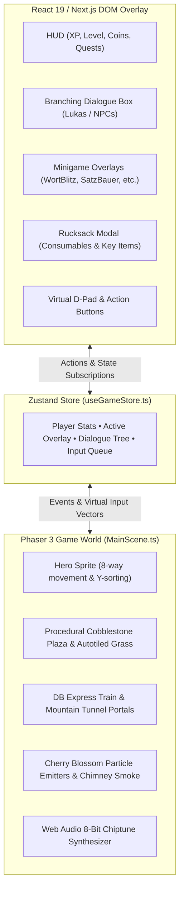

# 🏰 German Quest: Deutschstadt (Deutsche Stadt RPG)

<div align="center">

```
  ____                                     ___                  _   
 / ___| ___ _ __ _ __ ___   __ _ _ __     / _ \ _   _  ___  ___| |_ 
| |  _ / _ \ '__| '_ ` _ \ / _` | '_ \   | | | | | | |/ _ \/ __| __|
| |_| |  __/ |  | | | | | | (_| | | | |  | |_| | |_| |  __/\__ \ |_ 
 \____|\___|_|  |_| |_| |_|\__,_|_| |_|   \__\_\\__,_|\___||___/\__|
                      🇩🇪 DEUTSCHSTADT 🇩🇪
```

**An authentic GBA / Nintendo-inspired 2D Pixel-Art Educational RPG for mastering the German language.**

[](https://nextjs.org/)
[](https://react.dev/)
[](https://phaser.io/)
[](https://www.typescriptlang.org/)
[](https://tailwindcss.com/)
[](https://github.com/pmndrs/zustand)
[](https://developer.mozilla.org/en-US/docs/Web/API/Web_Audio_API)

[Story & Lore](#-the-world-of-deutschstadt) • [Architecture](#-hybrid-engine-architecture) • [Town Map & Minigames](#-the-5-town-institutions) • [Controls](#-controls--accessibility) • [Audio Engine](#-procedural-8-bit-sound-engine) • [Getting Started](#-getting-started)

</div>

---

## 🌟 Overview

**German Quest: Deutschstadt** transforms German language acquisition into an immersive, nostalgic retro RPG experience (inspired by *Pokémon FireRed*, *The Legend of Zelda: The Minish Cap*, and *Stardew Valley*).

Step off the Deutsche Bahn express train into **Deutschstadt**, a bustling historical German town with cobblestone alleys, blooming cherry blossoms, half-timbered architecture, and lively townsfolk. Explore institutions, converse with tutors, earn Gold & XP, solve grammar puzzles, and collect authentic German goods in your *Rucksack*!

---

## 🏰 The World of Deutschstadt

```
                          [ DAS RATHAUS ]
                     (Bürgermeister Schmidt)
                                │
   [ SPRACHSCHULE ]             │             [ DIE BIBLIOTHEK ]
   (Language Academy)           │             (Frau Weber)
         │                      │                    │
   [ DIE BÄCKEREI ]────[ COBBLESTONE PLAZA ]────[ ALTES MUSEUM ]
   (Bäcker Schmidt)    (Central Fountain & Lukas) (Historisches Archiv)
                                │                    │
   [ HAUPTBAHNHOF ]             │             [ DAS CAFÉ ]
   (Herr Braun & DB Train)      │          ("Gemütlichkeit")
                                │
                  ═══════ GLEIS 1 & GLEIS 2 ═══════
                    (Mountain Railway Cuttings)
```

---

## 🏛️ The 5 Town Institutions & Educational Minigames

Every institution in Deutschstadt is an interactive learning center with its own specialized minigame and NPC:

| Institution | Host / NPC | Challenge | Grammar & Vocabulary Topics | Reward |
| :--- | :--- | :--- | :--- | :--- |
| **🥐 Die Bäckerei** *(Bakery)* | **Bäcker Schmidt** | **Wort-Blitz** | Fast-paced German noun gender articles: `der`, `die`, `das` with combo multipliers | XP, Gold, *Die Brezel*, *Der Apfel* |
| **📚 Die Bibliothek** *(Library)* | **Frau Weber** | **Satz-Bauer** | Interactive sentence rebuilder: Verb-second rule (V2), TeKaMoLo order, and accusative/dative | XP, *Das Buch*, quest achievement |
| **🏛️ Das Rathaus** *(Town Hall)* | **Bürgermeister Schmidt** | **Bürger-Quiz** | 8 timed questions spanning German geography, history, culture, and grammar trivia | *Die Bürger-Urkunde*, Gold streak bonus |
| **☕ Café Gemütlichkeit** *(Café)* | **Herr Müller** | **Speisekarten-Match** | 12-card culinary memory match connecting German food terms with visual translations | XP, Gold, Café Master stars |
| **🚂 Der Hauptbahnhof** *(Main Station)* | **Herr Braun** | **Fahrkarten-Schalter** | Real-world travel dialogues, reading train departure boards, and buying rail tickets | *Die Fahrkarte*, DB conductor badge |

---

## 🕹️ Hybrid Engine Architecture

German Quest is engineered as a seamless **two-tier hybrid**:
- **Game Engine (Phaser 3)**: Manages the 2D world viewport, Arcade Physics, 8-direction player movement, NPC pathing, collision geometry, animated water fountain, falling blossom particles, and day/night atmospheric vignettes.
- **UI & Minigame Shell (React 19 + Tailwind CSS)**: Renders the retro-styled pixel HUD, inventory modal, branching dialogue boxes, and minigame overlays directly in the DOM using pixelated borders and Google Font's `'Press Start 2P'`.
- **State Bridge (Zustand Event Bus)**: High-speed, zero-boilerplate synchronization between Phaser canvas events and React component lifecycles.



---

## 🎮 Controls & Accessibility

German Quest is built to run natively on **desktop browsers, tablets, mobile phones, and TV remotes**:

### 💻 Desktop / Keyboard
* **`W` `A` `S` `D`** or **Arrow Keys** — 8-Directional Hero Movement (normalized diagonals)
* **`SPACE` / `E` / `ENTER`** — Interact with NPCs, read signs, or enter buildings
* **`I`** — Open / Close **Rucksack** (Inventory)
* **`1`, `2`, `3`** — Quick-select dialogue options & quiz answers
* **`G`** — Toggle virtual on-screen gamepad
* **`ESC`** — Exit active minigame or close overlay

### 📱 Mobile & Tablet (Touch)
* **Virtual Analog Stick**: Responsive touch-drag joystick on the lower-left.
* **Action Buttons**: Floating retro **[A] Action** button (lights up when an NPC or door is nearby) and **[Rucksack]** button on the lower-right.
* Automatically detects coarse pointer screens and stores preference in `localStorage`.

### 📺 Smart TV / Android TV (D-Pad & Remote)
* **Spatial D-Pad Navigation**: Built-in `useDpadNavigation` hook maps arrow keys to focusable elements with high-visibility amber focus rings.
* **`ENTER` / OK**: Triggers selected buttons even while Phaser global key capture is active.

---

## 🔊 Procedural 8-Bit Sound Engine

No massive audio assets or slow network requests! All sound effects in German Quest are generated procedurally in real-time via the **Web Audio API**:

- 🚂 **Train Horn**: Authentic two-tone harmonized German rail whistle ($F_4 + A_4$ with smooth pitch bend).
- 🐦 **Town Fauna**: Procedural bird tweets, Bavarian Dachshund barks, and gentle cat meows.
- 👣 **Dynamic Footsteps**: Crisp triangle-wave tap on cobblestone vs. soft filtered rustle on grass.
- 🪙 **Quest Jingles & Sparkles**: Ascending harmonic chimes for correct answers and item collection.
- 🎚️ **One-Click Mute**: Instant audio toggle via the HUD speaker icon.

---

## 🚀 Getting Started

### Prerequisites
- [Node.js](https://nodejs.org/) (v18.18.0 or later recommended)
- `npm` or `pnpm`

### Installation

1. **Clone the repository**:
   ```bash
   git clone https://github.com/your-username/german-quest.git
   cd german-quest
   ```

2. **Install dependencies**:
   ```bash
   npm install
   ```

3. **Start the local development server**:
   ```bash
   npm run dev
   ```

4. **Play the game**:
   Open [http://localhost:3000](http://localhost:3000) in your browser.

### Production Build
To create an optimized production build:
```bash
npm run build
npm run start
```

---

## 📁 Project Structure

```plaintext
german-quest/
├── public/
│   ├── assets/
│   │   └── buildings/        # Isometric & 3/4 town institutions (Rathaus, Bäckerei, etc.)
│   ├── characters/           # NPC illustrations & portraits (Lukas, Herr Braun, etc.)
│   └── fonts/                # 'Press Start 2P' retro pixel typography
├── src/
│   ├── app/                  # Next.js App Router (layout.tsx, page.tsx, globals.css)
│   ├── components/
│   │   ├── game/             # Game.tsx (Phaser canvas wrapper) & TouchControls.tsx
│   │   ├── minigames/        # WortBlitz, SatzBauer, BuergerQuiz, KaffeeMatch, FahrkartenSchalter
│   │   └── ui/               # HUD.tsx, DialogueBox.tsx, Inventory.tsx, PixelButton.tsx
│   ├── data/                 # vocabulary.json, dialogue.json, quests.json, questions.json
│   ├── game/
│   │   └── scenes/           # MainScene.ts (Phaser world, autotiling, physics, trains, lighting)
│   ├── hooks/                # useDpadNavigation.ts (TV remote & keyboard spatial focus)
│   ├── store/                # useGameStore.ts (Zustand state engine & event bus)
│   └── utils/                # audio.ts (Pure Web Audio chiptune synthesis)
├── context.md                # System design & feature architecture reference
├── prd.md                    # Product requirements document
└── package.json              # Project dependencies & scripts
```

---

## 🗺️ Roadmap & Future Quests

- [x] **Phase 1**: Terrain autotiling, procedural cobblestone paths, and environmental props.
- [x] **Phase 2**: Animated water fountain, swaying trees, and falling cherry blossom particle storms.
- [x] **Phase 3**: Living town ambient NPCs, wandering animals, and German flags.
- [x] **Phase 4**: Mountain railway cutting with dual tunnel portals, animated Deutsche Bahn express train.
- [x] **Phase 5**: Complete suite of 5 institution minigames with dialogue branches and inventory economy.
- [ ] **Phase 6**: Day / Dusk / Night cycle with dynamic lantern lighting.
- [ ] **Phase 7**: Multiplayer town square & cooperative vocabulary boss battles.

---

## 📜 License

Created with ❤️ for German language learners worldwide. Open source under the [MIT License](LICENSE).

<div align="center">
  <b>Viel Erfolg beim Deutschlernen! 🇩🇪🎒✨</b>
</div>

